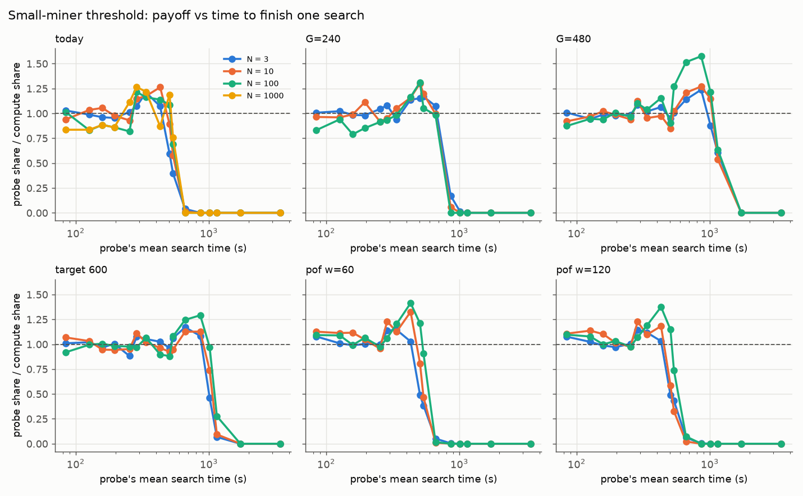
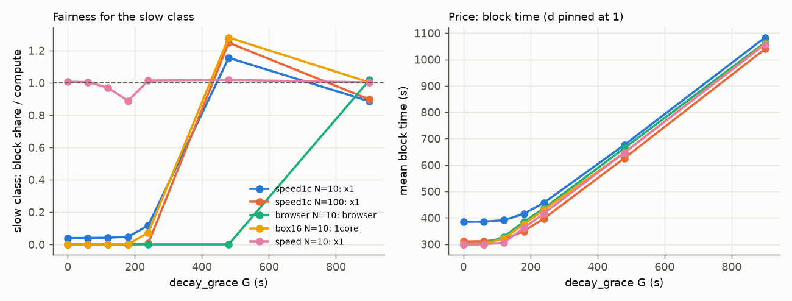
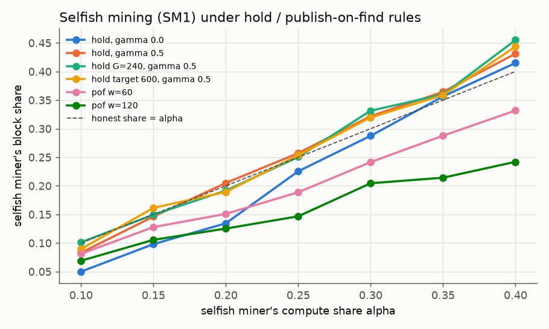

# Is SM64Coin mining fair, and what fixes it? (progress-aware model)

Research input for the planned hard fork. Branch `fairness-research` (from `headstart-research-slowdecay`).
Code: `fair.py` (simulator), `fair_run.py` (experiments), `fair_game.py` (budget / thread choice as a game), `fair_fit.py` (fits the
search law from every measured search), `fair_report.py` (tables + plots), `fair_measure_driver.py` (measurement queue for the
`runlen` bin, which gained `--steplog`). All tables: `fair_tables.md`; fitted model: `fair_model.json`; simulation outputs: `fair_results/`;
measured searches of this branch: `fair_measure/raw/*.jsonl` (one row per search) and `fair_measure/steps/*.log` (step logs).

Reproduce: `python fair_fit.py fair_measure` (tables of section 1/4, writes fair_model.json); `python fair_run.py mix,grace OUT --seeds 2 --blocks 1000 --eff 1:1,2:0.93,4:0.87`
(likewise `target,gracec,pof,backdate`, `attack`, `stamps,threshold`, `attack2`; `--law rho=0` for the sensitivity runs); `python fair_game.py OUT --blocks 1000 --seeds 3`;
`python fair_report.py fair_results/mix_grace.json,fair_results/target_gracec_pof_backdate.json,fair_results/attack.json,fair_results/stamps_threshold.json,fair_results/attack2.json fair_results/game.json`.
The simulations use the law in `fair.py` (`LAW`, fitted to the first 40 searches: shift 15.4 M, scale 14.35 M, sigma 0.677, run f0 1500 + lognormal(7.328, 0.374), rho 0.72);
`fair_model.json` has the refit on every search (section 1), which is within the fit's own uncertainty of it.

## 0. Answer in short

1. **What wins is the latency of ONE search, not clock speed as such and not total cores.** A search (one rrt tree) has to run for
   its whole cost before it yields any run, and the work is lost every block. Measured: 33.4 M emulated frames on average, never less than
   ~18 M (a hard floor: the castle step alone is ~7-11 M), at 38.8 k frames/s per thread, so **one search takes ~860 s on one thread
   (p10 ~550 s), ~250 s on 4 threads (one tree, measured scaling 0.87 per thread at 4 threads), ~1700 s in a browser worker (assumed 0.5x)**.
   - A miner whose mean search time is below ~1.5x the block interval gets its fair share (**share/compute 0.85-1.2**; the extra
     clock speed of a 1.3x / 1.6x machine buys exactly proportional share when everyone runs 4-thread searches: 0.88-1.08 at every network size).
   - Above that there is a **cliff**: at the 300 s target, mean search ~450 s -> ~1, ~540 s -> 0.4-0.7, **>= 660 s -> 0** (fair_threshold.png).
     Every one-thread native search (860 s at 1.0x) and every browser search is beyond it. Among one-thread machines the user's hypothesis
     holds exactly: **1.6x clock gets 2.0-2.4x its compute share, 1.3x gets 0.02-0.55x, 1.0x gets 0-0.04x** (N >= 10 machines);
     a 16-core box running 4 x 4-thread searches takes 100% against 16 one-core machines, and **browsers get 0 at every network size**.
   - So: per-core speed and threads per search are the same lever (both shorten one search); total cores buy proportional
     share only for a miner whose searches finish in time (the fast side of the cliff). More parallel searches per machine (more lottery tickets) beat fewer faster ones only when the
     slower searches still finish in time.
2. **The grace period does not fix this while the 300 s target is kept.** The block is decided at ~300 s whatever the limit's shape,
   so a search that needs 800 s never counts. With the retarget compensating (start_halvings lowered by G/60) a grace changes nothing
   (identical shares) and G >= 480 destabilises the retarget (interval CV 0.53). Without compensation the grace simply **adds G to
   the block time once d is pinned at 1**, and fairness then comes from the longer block, not from the grace: one-thread miners become fair at
   G = 480 (block ~650 s), browsers at G = 900 (block ~1050 s). A longer **target** gives the same fairness at the same block time
   (target 600: one-thread fair; 900-1200: browsers) and keeps the retarget working above d = 1; neither moves the attack numbers beyond noise (section 6).
3. **Budgets are not a usable lever for slow miners.** The search's success probability is a hard-floored curve (no find below ~18 M frames;
   increasing hazard up to ~35 M), and a restart only wastes the floor again; the per-step data show the same for both steps, and the real
   miner's course-budget knob is harmful below the course step's cost (12 M: 9 of 12 paired searches gave longer runs, up to 3.5x, mean +54%, at 1.48x the frames). Best responses
   in the game move by less than the noise for 4-core natives (flat payoffs) and **no budget lets a one-thread or browser miner cross the cliff**.
   The equilibrium is "everyone uses the default budget"; the grace is not needed for budget reasons.
4. **Signed proofs + publish-on-find with a shorter-run displacement window omega**: with honest miners waiting for the window, the head start
   is gone (W 0 vs ~100-120 s today) and **selfish mining stops paying up to alpha = 0.4 in SM1** (today: threshold 0.35-0.4 at gamma = 0, **0.15-0.2 at gamma = 0.5**).
   The auction's shortest-run selection survives (it is the window's rule). Costs: the tip flips in ~17% of blocks within a 60 s window
   (no wasted work if miners wait), an author can still start early privately (W ~150 s with H = 120, it then risks displacement), and a long window makes
   private chains easier (P(success at z = 6) for a 33% attacker 0.31 today, 0.28 at omega 60, 0.45 at omega 120).
5. **Timestamps**: in the grace regime back-dating is self-limiting (blocks found before their valid time are published at it: nothing to back-date;
   measured gap 0-9 s at G >= 240) and none of the stamp games (fast miners back-dating, slow miners forward-dating +120 s, both) moved shares by more
   than noise. Without any bound, back-dating accumulates in the search-bound regime (stamps lag real time by hours), which erases any grace;
   a freshness bound of Delta caps it at Delta per block. Relay policy is enough; G should be >= 2-4 Delta.
6. **Recommendation** (section 9): `decay_grace = 0` (keep the test's "no grace"); `target_seconds` 300 -> **600** if one-thread / slower
   machines should earn (900-1200 for browsers), otherwise keep 300 and make one search short instead (miner defaults: one tree on all cores, up to 4+
   threads; the web miner's workers on one shared tree); **publish-on-find + signed proofs with omega = 60 s** (wait-for-window as the honest default),
   together with the equivalence/equivocation rules already planned; freshness bound Delta = 60 s as relay policy.

## 1. What was measured (new on this branch) and what is modelled

| quantity | value | source |
|---|---|---|
| frames/s per search thread | 38.8 k per CPU-second (wall ~35.4 k at load ~20-28 on 16 cores) | 36 MEASURE.md searches + this branch's runs (`wait4` CPU) |
| thread scaling of ONE search (one tree, threads share it) | per thread: 2 threads 0.93-0.98, 4 threads 0.81-0.98 (mean 0.87); the search is the same (same run, same frames ±1%) | 4 paired sets, same target and seed, 1/2/4 threads |
| search cost T (frames until the first run) | mean 33.7 M, median 30.4 M, min 17.9 M, max 106 M; 3-parameter lognormal: shift 15.1 M, scale 15.0 M, sigma 0.65 | 48 independent default searches (3 live-chain targets) |
| run length F of that search | mean 3035, sd 576 | same |
| cost vs run length | **Spearman 0.63, within-target normal-score rho 0.63 (bootstrap 10-90%: 0.53-0.74)**; 0.72 on the first 36: searches that finish early also find SHORT runs | same |
| steps of a search | castle step 6.8-11.3 M (35/35 reached a course), course step to the star 5.7-43 M (median 15 M); checkpoints mostly when the course budget is cut | 35 step logs (`runlen --steplog`) |
| course budget (miner knob, default 150 M) | 20 M: mean run 3348 vs 2761 (6/12 unchanged, worst 2.96x); **12 M: 4244 (9/12 longer, worst 3.54x), 1.48x the frames** | 12 paired seeds per arm (section 4) |

Per-search time from that law (mean / p10 / p50 / p90, seconds):

| miner | frames/s per search | mean | p10 | p50 | p90 |
|---|---|---|---|---|---|
| native, 1 thread, 1.0x | 38.8 k | 861 | 552 | 767 | 1278 |
| native, 1 thread, 1.6x | 62 k | 538 | 345 | 479 | 799 |
| native, 2 threads | 72 k | 463 | 297 | 412 | 687 |
| native, 4 threads (automine default) | 135 k | 247 | 159 | 220 | 367 |
| browser worker (1 thread, 0.5x assumed) | 19.4 k | 1722 | 1104 | 1534 | 2556 |

**Measured**: everything in the two tables (except the browser's 0.5x speed, which is an assumption: no WASM benchmark exists in the repo).
**Modelled**: the network (miners, compute shares, propagation 2 s, first-seen ties), that searches are independent draws from the fitted
joint law (Gaussian copula on cost and run length), that a miner runs `cores / threads` searches at once and starts a new one after each find,
the commit rule (H = 120 s, RESULTS.md), the rules (rules.rs `max_frames` continuous in level8, Monero retarget window 60 cut 6),
the attacks (SM1, private chain) and all rule variants. Load: the machine was shared (load 20-30 on 16 cores) for every measurement; CPU-seconds
per frame do not depend on it, wall time does (idle is not 2x faster per CPU-second: the per-CPU-second rate was the same as in MEASURE.md).

Today's chain: blocks 26-36 came 298-28875 s apart (median ~1800 s), difficulty 1: far slower than any of the modelled networks, i.e. few,
intermittent miners. In that regime the first finished search wins (latency race) - the same cliff applies, only the block time is long.

## 2. Model (fair.py)

- A miner = (cores, per-core speed, threads per search k, restart budget b, commit horizon H). It runs `cores // k` searches in parallel; a search of
  cost T finishes `T / (speed * 38.8k * k * eff(k))` s after it starts and yields one run of F frames ((T, F) drawn jointly); the slot then starts
  the next search on the same parent. A search that has used b frames without a find is dropped and restarted. Everything restarts when the miner
  switches parent (progress is lost every block: the next block's pokes and start state are new).
- Validity: run F is valid `G + 7.5 s * (level8(d) + 8*start_halvings - ln(36000/F)/0.0202)` after the parent's stamp (0 if it already fits).
  **hold** (today): nodes hold a run until valid; the earliest valid run wins; the winner may have committed to it H = 120 s before it was valid and
  started the next height privately (head start W). **pof**: runs are relayed at find and eligible at validity; within omega of the first eligible sibling
  a strictly shorter eligible sibling displaces it; honest miners keep searching the height until the window closes (H = -1), or authors start early (H = 120).
- Check: with memoryless searches and every run valid on find the SM1 code reproduces Eyal-Sirer (alpha 0.2/0.3: 0.130/0.278 vs theory 0.130/0.273 at
  gamma = 0; 0.191/0.334 vs 0.182/0.327 at gamma = 0.5); at alpha 0.4 it is 0.04 below theory (a lead > 2 is cashed in at once: conservative).
- Not modelled: latency beyond 2 s, miners joining/leaving, per-target differences (the law pools 3 targets), and anything about the search beyond
  its (cost, run) law; the browser speed.

## 3. Fairness today (hold, G = 0, target 300): share / compute per class

(N = network size in 4-core machine units; 2 seeds x 1000 blocks; noise about ±0.05 on a ratio; full tables in `fair_tables.md`)

| mix | N = 3 | 10 | 30 | 100 | 1000 |
|---|---|---|---|---|---|
| 4-core, 4 threads/search, clock 1.0 / 1.3 / 1.6 | 1.07 / 0.91 / 1.03 | 1.01 / 0.94 / 1.05 | 0.92 / 1.06 / 1.01 | 0.90 / 1.07 / 1.00 | 0.88 / 1.08 / 1.01 |
| 1-core, 1 thread/search, clock 1.0 / 1.3 / 1.6 | 0.26 / 0.85 / 1.59 | 0.04 / 0.55 / 1.97 | 0.00 / 0.23 / 2.25 | 0.00 / 0.02 / 2.42 | 0.00 / 0.00 / 2.44 |
| one 16-core box (4 x 4 threads) / 16 one-core machines | 2.00 / 0.00 | 1.69 / 0.00 | 1.16 / 0.00 | 1.01 / 0.00 | 1.00 / 0.00 |
| the box on 16 one-thread searches / 16 one-core | 1.00 / 1.00 (blocks 494 s) | 0.00 / 0.00 | 0.00 / 0.00 | 0.00 / 0.00 | 0.00 / 0.00 |
| one farm (40%) / many 4-core machines | 0.96 / 1.02 | 1.02 / 0.98 | 1.00 / 1.00 | 1.00 / 1.00 | 0.98 / 1.02 |
| native 4-core / browsers (half the machines) | 1.50 / 0.00 | 1.50 / 0.00 | 1.50 / 0.00 | 1.50 / 0.00 | 1.50 / 0.00 |
| 40 / 30 / 20 / 10 % farms | ~1 each | 1.02 / 0.96 / 0.96 / 1.10 | 0.99 / 1.04 / 1.02 / 0.86 | 1.01 / 1.01 / 0.98 / 0.97 | 0.99 / 1.06 / 0.99 / 0.90 |

Block time 299-300 s (one-core networks: 290-464 s, d pinned at 1), interval CV 0.03-0.15, stale 1-19% (rising with N: many runs become valid within the 2 s
propagation of each other), head start W ~100-120 s for 4-thread networks, 0 for one-thread networks (search-bound: found after valid).

**Threshold** (`fair_threshold.png`, probe miner with 5% of the compute in a network of 4-thread natives): share/compute vs the probe's mean search time:
85-450 s: 0.82-1.27; 507 s (4 threads at 0.5x): 0.59-1.09; 539 s (1 thread at 1.6x): 0.40-0.69; 663 s: 0.00-0.04; >= 860 s: 0.
The cliff is at a mean search time of ~1.7-2x the block interval (p10 of the search ~ the time the block is decided).
It does not depend on N (3 to 1000) - the order statistics of the first finishers are bounded below by the 18 M frame floor.
Just under the cliff a miner gets *more* than its share (1.15-1.3): with one thread per search it holds more tickets, and finishing late is fine as long as it finishes.

## 4. Budgets and threads as each miner's strategy

**Success vs budget (one search, measured law; restart after b M frames):**

| b (M frames) | 18 | 20 | 22 | 25 | 28 | 30 | 35 | 40 | 50 | 60+ |
|---|---|---|---|---|---|---|---|---|---|---|
| P(find within b) | 0.03 | 0.05 | 0.07 | 0.28 | 0.45 | 0.50 | 0.70 | 0.85 | 0.93 | 0.95-0.97 |
| cost per find (M) | 720 | 399 | 291 | 89 | 58 | 55 | 42 | 36 | 34 | 34 |
| mean run of those finds | 2332 | 2387 | 2396 | 2577 | 2665 | 2702 | 2893 | 3004 | 3040 | 3045 |

The hazard rises until ~35 M (shifted law: nothing below the floor), so restarts cost throughput at every b < 40 M (Luby-style restarts only help
a decreasing hazard). They do buy short runs (cost and run length are correlated), but each find costs 1.6-20x more.
Per step (step logs): the castle step costs 6.8-11.3 M and always reached a course; the course step ending in the star 17.7-18.9 M; a course budget below
the course step's cost ends the tree in a checkpoint and a fresh tree goes on from there - measured paired with the default search of the same seed:

| step budget b (M frames) | 8 | 10 | 12 | 15 | 18 | 20 | 25 | 30 |
|---|---|---|---|---|---|---|---|---|
| castle step reaches a course within b (n = 35) | 0.37 | 0.94 | 1.00 | 1.00 | 1.00 | 1.00 | 1.00 | 1.00 |
| first course step reaches the star within b (n = 10, default searches) | 0 | 0 | 0.10 | 0.10 | 0.50 | 0.60 | 0.70 | 0.70 |
| both (castle b, course b): the chained probability | 0 | 0 | 0.10 | 0.10 | 0.50 | 0.60 | 0.70 | 0.70 |

Course steps that end in the star cost 5.7-43 M (median 15 M); the castle step 6.8-11.3 M (median 8.3 M). The miner's own knob, measured on 12 paired
seeds per arm (4 threads, same target and search seed as a default search):

| course budget | same run as default | longer | shorter | run / default (sorted) | search cost / default (sorted) | mean run |
|---|---|---|---|---|---|---|
| 150 M (default) | | | | | | 2761 |
| 20 M | 6 | 3 | 3 | 0.89 0.89 0.92 1 1 1 1 1 1 1.21 **1.90 2.96** | 0.79-1.9 (mean 1.14) | 3348 |
| 12 M | 0 | 9 | 3 | 0.79 0.92 0.95 1.02 1.2 1.41 1.42 1.73 1.75 2.01 2.39 **3.54** | 0.63-4.4 (mean 1.48) | 4244 |
The chain is a product of steps with floors, so cutting a step below its floor does not give a cheap lottery ticket; it gives a longer chain of
checkpoints or a failure.

**Game** (`fair_game.py`; strategy per class: threads per search 1/2/4, restart budget inf/45/35/28/22 M; best responses iterated, 3 seeds x 1000 blocks):
| mix (N, G) | class: compute -> default share -> equilibrium strategy (k, b) and share |
|---|---|
| 4-core, clock 1.0/1.3/1.6 (10, 0) | 0.256 -> 0.267 -> (2, inf) 0.243; 0.333 -> 0.321 -> (2, inf) 0.364; 0.410 -> 0.412 -> (2, inf) 0.393 |
| same (100, 0) | 0.256 -> 0.236 -> (2, inf) 0.290; 0.333 -> 0.345 -> (2, inf) 0.332; 0.410 -> 0.419 -> (4, 22) 0.378 |
| same (10, 240) | 0.256 -> 0.267 -> (2, inf) 0.267; 0.333 -> 0.334 -> (4, 28) 0.297; 0.410 -> 0.399 -> **(1, 28) 0.436** |
| same (100, 240) | 0.256 -> 0.276 -> (4, 28) 0.246; 0.333 -> 0.338 -> (4, 22) 0.302; 0.410 -> 0.387 -> **(1, inf) 0.451** |
| 1-core, clock 1.0/1.3/1.6 (10, 0 / 240) | nobody moves (k = 1 is forced; no budget helps): 0.007 / 0.200 / 0.793 and 0.04 / 0.38 / 0.58 |
| native / browser (10 and 100, 0 and 240) | browsers 0.000 under every strategy; natives keep (4, inf) |
| 40% farm / 4-core machines (10, 0 / 240) | farm 0.41 -> 0.40 and 0.37 -> 0.39: within noise |
| 16-core box / 16 one-core (3, 0 / 240) | 1.00 / 0.00 and 0.95 / 0.05: one-core miners have no strategy that helps |

(Classes move when a candidate beats the current strategy by > 0.005, which is below the noise of ~0.01-0.02 per share, so most moves are noise;
all runs "converged" within 4 rounds.) What is real: (i) **for 4-core natives at G = 0 the payoff landscape is flat** - threads 2 or 4, restart budgets
22-inf M all within ±0.03 - so the default is an equilibrium in practice and it is proportional; (ii) **no strategy lets a one-thread or browser miner past the cliff**;
(iii) when the block gets longer (grace 240 -> 377-416 s blocks) **the fastest clock gains by switching to one-thread searches** (more tickets that still finish in
time): 1.6x share 0.39-0.40 -> 0.44-0.45 (share/compute 0.95 -> 1.07-1.10), the others lose. So with optimised budgets/threads the outcome is *slightly less*
proportional than the default when blocks are longer, and the grace is not needed for budget reasons: budgets are not what decides.

## 5. The grace period (decay_grace)

- **As written (start_halvings 20)**: with d pinned at 1 every block waits G + ~150-200 s, so the grace is a minimum block time. Slow class share/compute
  (one-core 1.0x at N = 10 / 100; browsers N = 10):  G 0: 0.04 / 0.00 / 0.00; 120: 0.04 / 0.00 / 0.00; 180: 0.05 / 0.00 / 0.00; 240: 0.12 / 0.01 / 0.00;
  480: 1.15 / 1.25 / 0.00; 900: 0.89 / 0.90 / 1.02. Mean block time: G 0-120: 300-390 s, 240: 400-456, 480: 610-676, 900: 1025-1083.
  For 4-thread networks the grace changes nothing but the block time (shares within noise at every G).
- **With the retarget compensating (start_halvings 20 - G/60, block time stays 300 s)**: shares identical to G = 0 in every mix (e.g. one-core N = 10:
  0.04 / 0.55 / 1.97 at G = 0, 120, 240, 480); at G = 480 the interval CV jumps from 0.09-0.14 to 0.51-0.55 (p95 500-520 s).
- **A longer target instead** (retarget works; no grace): one-core 1.0x share/compute at target 300 / 450 / 600 / 900 / 1200: N = 10: 0.04 / 0.09 / 0.82 / 1.13 / 0.90;
  N = 100: 0.00 / 0.16 / 1.24 / 1.08 / 0.92; N = 1000: 0.00 / 0.40 / 1.28 / 1.03 / 1.00. Browsers: 0.00 / 0.00 / 0.00 / 0.03-0.32 / 1.04-1.32.
  16 one-core machines vs a 16-core box: fair from target 600 (1.25 / 0.86 at N = 10). Interval CV 0.03-0.09, p95 = 1.04-1.1 x mean.
- Why: the block is decided when the best *finished* run becomes valid; whatever the limit's shape, the retarget puts that at the target. Only the time
  available per block (block interval) decides which searches can finish. The grace was meant to make "shortest run among completed searches" the rule;
  it already is the rule (the auction); what is missing is time.

## 6. Security of each option (SM1 selfish threshold; private chain from the tip)

Selfish revenue share (C = 100 4-core machines, 8 honest miners, H = 120; 2 seeds x 2000 blocks):

| rule | gamma | alpha 0.1 | 0.15 | 0.2 | 0.25 | 0.3 | 0.35 | 0.4 | threshold |
|---|---|---|---|---|---|---|---|---|---|
| hold (today) | 0 | 0.050 | 0.098 | 0.135 | 0.226 | 0.287 | 0.356 | 0.415 | 0.35 |
| hold (today) | 0.5 | 0.083 | 0.146 | 0.205 | 0.257 | 0.322 | 0.364 | 0.431 | **0.2** |
| hold, G = 240 | 0 | 0.067 | 0.106 | 0.166 | 0.227 | 0.303 | 0.357 | 0.448 | 0.3 |
| hold, G = 240 | 0.5 | 0.101 | 0.149 | 0.192 | 0.251 | 0.331 | 0.360 | 0.455 | **0.1** |
| pof omega 60 | any | 0.081 | 0.128 | 0.151 | 0.189 | 0.241 | 0.288 | 0.332 | **> 0.4** |
| pof omega 120 | any | 0.069 | 0.106 | 0.125 | 0.147 | 0.205 | 0.214 | 0.242 | > 0.4 |
| pof omega 60, G = 240 | any | 0.068 | 0.116 | 0.139 | 0.185 | 0.242 | 0.288 | 0.333 | > 0.4 |
| hold, target 600 | 0 | 0.045 | 0.091 | 0.136 | 0.215 | 0.299 | 0.332 | 0.426 | 0.4 |
| hold, target 600 | 0.5 | 0.089 | 0.162 | 0.189 | 0.254 | 0.320 | 0.359 | 0.443 | 0.15 |
| hold, G = 480 | 0 | 0.046 | 0.110 | 0.142 | 0.213 | 0.306 | 0.341 | 0.410 | 0.3 |
| hold, G = 480 | 0.5 | 0.090 | 0.134 | 0.187 | 0.247 | 0.325 | 0.354 | 0.440 | 0.3 |
| pof omega 60, target 600 | any | 0.078 | 0.132 | 0.152 | 0.213 | 0.264 | 0.308 | 0.360 | > 0.4 |

The "threshold" (first alpha whose share exceeds alpha) moves by a step with ±0.01-0.02 noise in a share; read the rows, not the threshold column:
under hold every row crosses the diagonal between 0.15 and 0.35 at gamma = 0.5 and between 0.3 and 0.4 at gamma = 0; under pof no row crosses it up to 0.4.

Private chain: confirmations z for P(success) < 0.1% (400 trials, tail fit beyond the sample), and P at z = 6:

| rule | 10% | 20% | 33% | P(z=6) at 20% / 33% |
|---|---|---|---|---|
| hold (today) | 6 | 20 | 104 | 0.025 / 0.31 |
| hold, G = 240 | 11 | 27 | 230 | 0.07 / 0.47 |
| pof omega 60 | 8 | 23 | 117 | 0.04 / 0.28 |
| pof omega 120 | 14 | 50 | 217 | 0.11 / 0.45 |
| pof omega 60, G = 240 | 7 | 23 | 106 | 0.07 / 0.39 |
| hold, target 600 | 10 | 19 | 107 | 0.04 / 0.34 |
| hold, G = 480 | 8 | 14 | 107 | 0.04 / 0.31 |
| pof omega 60, target 600 | 7 | 30 | 108 | 0.05 / 0.33 |

z for 33% is a tail extrapolation with a factor-2 uncertainty (G = 240's 230 and G = 480's 107 are within it); P(z = 6) is the robust column:
0.28-0.34 for today, target 600, G = 480 and omega 60; 0.39-0.47 for G = 240 and omega 120.

Read: the grace and a longer target leave both attacks where they are today, within the noise (selfish rows within ±0.02 of today's; P(z=6) at 33%
0.31-0.34, except G = 240's 0.47). All private-chain numbers are much worse than SLOWDECAY.md's Poisson ones (z(33%) ~105 vs 50): searches cannot finish
faster than their 18 M frame floor, so block production is nearly time-bound and a minority chain keeps pace; a longer window (omega 120) adds to that.
Under pof a withheld block is worth less: honest miners see every pending run, the window decides a lead-1 race by run length (gamma plays no part), and
the honest miners lose nothing to the selfish miner's early start because nobody starts the next height before the window closes.

## 7. Publish-on-find with signed proofs: honest metrics

(`fair_tables.md` section pof; G = 0, omega 30 / 60 / 120; H = -1 honest wait, H = 120 author starts early)

- **Head start**: W = 0 when everyone waits for the window; an author who commits early gets W = 130 / 150 / 170-180 s (omega 30 / 60 / 120) but
  risks displacement; shares stay within noise of compute either way for 4-thread networks (e.g. speed mix N = 10, omega 60: 0.94 / 0.99 / 1.05 waiting,
  1.14 / 0.96 / 0.94 author-early).
- **Shortest-run selection survives** (it is the window's rule) and gets slightly stricter: winning runs 2324 vs 2332 (N = 10), 2072 vs 2074 (N = 100).
- **Tip flips**: the first eligible block is displaced by a shorter one in 6-10% / 17-19% / 21-35% of blocks at omega 30 / 60 / 120 (4-thread networks), 13-66% in one-thread networks
  (runs arrive spread out). With honest waiting nobody has built on the displaced block; it is a UI/explorer event, not lost work.
- **Fairness**: omega lengthens the decision in search-bound networks, so it helps one-thread miners a little (one-core 1.0x at N = 10: 0.04 -> 0.07 / 0.15 / 0.33
  for omega 30 / 60 / 120, block time 384 -> 416 / 445 / 502 s); it does nothing for browsers. It is not a fairness fix.
- Block time / stability: unchanged at d > 1 (299-300 s); interval CV 0.10-0.11 / 0.11-0.15 / 0.15-0.21 vs 0.09-0.13 today, p95 +20 s at omega 60 and +50-60 s at omega 120 (the window decides which of several close runs counts).

## 8. Grace and timestamps (back-dating, forward-dating, freshness)

The child's limit clock starts at the parent's stamp; consensus accepts any stamp in `[T_P + g(F) (+ G), now + 120]` above the median.

- **Back-dating** (stamp as early as the run allows, or `publication - Delta` under a freshness bound): in the grace regime blocks are held until valid
  and published at that moment, so there is nothing to back-date: measured gap 1-9 s at G = 240, 0 at G >= 480 (one-core networks N = 10 / 100).
  Fast miners back-dating every block they win, everyone back-dating, slow miners forward-dating by 120 s, or both: shares change by <= 0.04 in every
  cell (`fair_tables.md` / pre4 "stamps"). Forward-dating delays the child's clock for everyone (block +28-37 s at G = 480-900): mild self-harm, and
  `hold_until` already makes the block itself wait for the node's clock, so it gains nothing.
- **Without a bound** back-dating accumulates where blocks are found after they are valid (G = 0, search-bound): stamps fell behind real time by
  hours (mean gap 0.6-56 k s) while the retarget saw 300 s blocks. That erases any grace and fools the retarget. With a freshness bound the lag is capped at
  Delta per block (measured gap = Delta).
- **Withholding** a valid block D s (and back-dating it so the child's grace looks shorter to others): always loses in this model - others publish in the
  meantime: the 30% farm's share/compute falls to 0.39-0.48 at D = 30 and ~0 at D >= 60 for every G (`backdate`).
- **Stamp-free clock** (the child's clock starts at the parent's earliest-valid time): identical to stamps when blocks are held (G >= 240); when blocks are found
  late the clock lags real time and the grace is gone for the child (the recursive definition drifted ~150 s per block in a one-core network at G = 0, so every run was
  valid on find). It removes back-dating but loses the grace exactly when the parent was found late.
- **Is the freshness bound needed as consensus?** No: back-dating only matters for blocks found after they were valid, and an honest miner uses its own
  node's arrival time to pick a parent; relay/tie-break policy (stale tips are not relayed and lose same-height ties; a longer chain still wins, so syncing
  nodes and partitions converge) caps the lag at Delta for every miner that runs it. Consensus cannot see arrival time, so a consensus form would have to be
  "stamp >= median of the last k + something", which a back-dater meets anyway. If a grace is adopted: Delta = 60 s, G >= 4 Delta (240 s).

## 9. Recommendations (rule parameters and miner defaults)

**Consensus (the fork):**

| parameter | recommendation | why / trade-off |
|---|---|---|
| `decay_grace` | **0** (keep `assert_eq!(r.decay_grace, 0, "the auction: no grace")`) | at a fixed target it changes nothing (compensated) or is just a longer block with a deterministic floor (uncompensated); G >= 480 compensated makes the retarget oscillate (CV 0.5) |
| `target_seconds` | **600** if one-thread natives and slower machines should earn; 900-1200 for single-worker browsers; 300 only if mining is meant for multi-thread natives | the only rule lever that moves the cliff: it sits at a mean search time of ~1.7-2x the block interval (300 s -> ~500 s, 600 s -> ~1000 s). Cost: confirmations take 2x the wall time for the same z, emission per day stays as it is because Monero's reward is per minute (`get_block_reward`: `emission_speed_factor = 20 - (target_minutes - 1)`, tail `FINAL_SUBSIDY_PER_MINUTE * target_minutes`), but `DIFFICULTY_TARGET_V2` (\"must equal Rules::target_seconds()\") is a single constant today, so the fork needs a height-switched V3 target in both places, the head start stays ~110 s (a smaller fraction of the block). Security per block unchanged (section 6). |
| signed proofs + publish-on-find | **yes**, with displacement of the first eligible block by a strictly shorter eligible run of a **different key** within **omega = 60 s** of the first one becoming eligible (or before any child of it is eligible, which cannot happen within 60 s) | removes the head start for miners who wait for the window and stops SM1 paying up to alpha 0.4 (today 0.15-0.35 at gamma 0.5); keeps the shortest-run auction. Needs the signatures (otherwise a displacement could be ground from someone else's run). Cost: the tip flips in ~17% of blocks during the window; private chains slightly easier at omega 120, so do not go above 60. |
| freshness bound | Delta = 60 s, **relay / tie-break policy** (not consensus) | caps back-dating at Delta per block; only needed if blocks are found after they are valid (search-bound). Ships in a normal node release (hardfork-design-list item 2). |
| `decay_halving`, `start_halvings`, `min_frames` | unchanged (60, 20, 600) | SLOWDECAY.md |

**Miner defaults (not enforceable, but each is in the miner's own interest):**

- Native: **one tree on all the machine's cores** (automine's `--rh-threads`, default 4; measured 0.87 per thread on average at 4 (0.81-0.98), more threads not measured).
  Below the cliff, latency is everything; above it, extra parallel searches are worth slightly more than faster ones (probe 1.15-1.3 at 290-430 s), so a
  big machine should run as many 4-thread trees as keep the mean search time under ~1.5x the block interval.
- **Keep the default budgets** (`--rrt-course-frames 150 M`, hub 60 M) and no restart budget: cutting the course budget to 20 M / 12 M made the mean run 21% / 54% longer
  (worst 3x / 3.5x; section 4); restarts below ~40 M cost 1.1-20x more frames per find. No budget rescues a miner beyond the cliff.
- Web miner: put the workers on **one shared tree** (the existing tree sync / shared castle step) instead of independent searches: 4 workers x 0.5x
  would bring a browser search from ~1700 s to roughly 450-550 s (scaling of tree sync not measured: open item); with a 600 s target that is well
  inside the fair zone, with 300 s it is at the cliff.
- Under publish-on-find: keep searching the height until the window closes (the default the numbers assume); starting the next height early on your
  own pending run gains nothing measurable (shares within noise) and loses the work when displaced.
- Show the miner its own mean time per search next to the block target (and warn when it is above ~1.5x): today a one-core or browser miner
  on a busy network earns nothing and cannot tell why.

## 10. Evidence quality

- **Measured** (this branch + MEASURE.md): the per-search cost law and its floor (48 searches, 3 targets), the cost-run correlation, thread scaling of one
  tree (paired same-seed runs at 1/2/4 threads: same run, scaling 0.87 per thread at 4), the per-step costs (35 step logs) and the course-budget arms (12 paired seeds each; see
  section 4), the chain's real block times (288-28875 s). The machine was loaded (load 20-30 on 16 cores) throughout; per-CPU-second rates are stable,
  wall times are not.
- **Assumed**: browser speed 0.5x native per thread (no WASM benchmark in the repo; the cliff makes the exact factor matter little: any browser search
  over ~600 s gets 0 at the 300 s target), 4-core machines as the unit, 2 s propagation, honest commit H = 120 s, independent searches (the guided/shared modes
  of the web miner, which share the castle step and checkpoints, are not modelled; sharing the castle step would cut a browser search by ~25%).
- **Sensitivity to the cost-run correlation** (`fair_run.py mix --law rho=0` / `rho=0.9`): one-core 1.0 / 1.3 / 1.6x at N = 10: 0.04 / 0.56 / 1.96 (rho 0),
  0.04 / 0.55 / 1.97 (0.72), 0.04 / 0.55 / 1.97 (0.9); browsers 0 in all; 4-thread clock mix within ±0.1 of 1 in all. The correlation changes the winning run
  (2994 vs 2632 frames in one-core networks) and the head start (W 77-111 s at rho 0 vs 98-120), not who wins. (One outlier: the 40% farm at N = 100, rho 0: 0.74.)
- **Modelled**: all shares, block-time statistics and attack numbers. Noise: ±0.05 on a share ratio, ±0.01-0.02 on a selfish share, z beyond ~30 is a tail
  extrapolation. The cliff's position and the "grace = longer block" result are robust to the law (they follow from the 18 M frame floor and the retarget).
