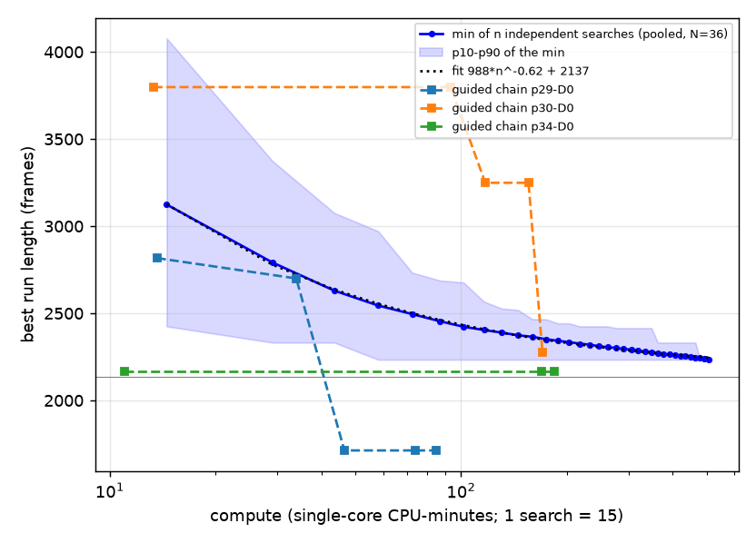
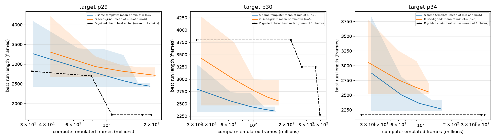

# Measured best run length vs search compute (native miner, the real rrt search)

Phase 1 of the slow-decay question (SLOWDECAY.md is phase 2). Everything is reproducible from `pow/miner/src/bin/runlen.rs`
(new bin: runs the real `rrt::mine` from a parent end state under a chosen perturbation seed, submits nothing),
`measure_driver.py` (job queue), `measure_analyze.py` / `measure_fit.py` / `measure_boot.py` (analysis). Raw rows: `measure_results.jsonl`.

## Set-up

- Binary: built from `git archive HEAD pow` of this branch (sm64coin main + headstart research), `cargo build --release --offline`, so the search is exactly the
  automine one (`rrt::mine`, default budgets 60 M hub / 150 M course frames per tree step, 1 thread per search, stops at the first state with more progress).
- Three real block targets from the live node (heights 29, 30, 34 are the parents; blocks 30, 31, 35 are the targets; chain was at height 35): **p29** 5 -> 6 stars,
  **p30** 6 -> 7, **p34** 10 -> 11. Parent end states were fetched once with `get_sm64_state` and cached; retarget difficulty 1 so the limit never cuts a run off (36000 frames).
- Arms (search seeds are deterministic: `p29-S0` reproduces the smoke run exactly):
  - **S** same template (fixed pokes), independent searches, only the search seed differs (6-7 per target);
  - **G** seed grinding: every search on a different template, i.e. a different perturbation seed (pokes), search seed 0 (5-6 per target);
  - **D** deep: a chain of K = 5 searches on one template, each guided by the objective keys of the best run so far (`OBRRT_GUIDE_KEYS`, weight 20, i.e. automine's anytime mode), 1 chain per target.
- Compute is counted as emulated frames (`sim_frames`) and CPU-seconds (`wait4` rusage of the process tree). One search costs **33.8 M frames and 871 CPU-s (14.5 core-minutes)**
  on average, i.e. about 39 k frames/s per core; the machine was shared and at load 25-50 for the whole run, so CPU-seconds are inflated, perhaps ~2x versus an idle core.
  Total: 36 independent searches + 3 guided chains (13 searches) ~ 2.2 G frames.
- **Budget caveat.** The brief asked for 24 S + 24 G per target and 1x..32x budgets. On this machine (load stayed above 24, so the driver throttled itself)
  a search took 10-20 minutes wall; I stopped at 36 independent searches (18 S + 18 G) and 3 guided chains. The compute axis therefore goes to ~16 independent searches (232 core-min) via
  subsampling the pool, not to 32x of a base with many repeats, and a first-find stops the tree (the miner has no "keep growing the same tree after the find" mode;
  more compute = more independent trees, or guided trees, which is also what automine's anytime mode does).

## Result 1: single search (what one find costs)

| | mean | median | sd | min | max |
|---|---|---|---|---|---|
| pooled, N = 36 (S+G, 3 targets) | 3127 | 3036 | 591 | 2234 | 4278 |
| p29 (13) / p30 (12) / p34 (11) | 3285 / 3109 / 2963 | | | | |

The real search finds a star in about 2200-4300 frames (1.2-2.4 minutes of play) from these states; the chain's own blocks 25-34 are 2313-5449.
**Seed grinding does nothing detectable**: same pokes vs different pokes give the same single-search law
(KS p = 0.62 / 0.47 / 0.82, Mann-Whitney p = 0.95 / 0.13 / 0.66 for p29 / p30 / p34; means 3272 vs 3298, 2795 vs 3424, 2876 vs 3061).
So a re-roll of the template is just another independent search; it has no better or worse tail than repeating the search on the same template.

## Result 2: best run vs compute (min of n independent searches, pooled)

| n searches | core-min | frames of compute (M) | mean best (frames) | p10 | median | p90 |
|---|---|---|---|---|---|---|
| 1 | 15 | 34 | 3124 | 2425 | 2995 | 4078 |
| 2 | 29 | 68 | 2792 | 2332 | 2688 | 3374 |
| 4 | 58 | 135 | 2545 | 2234 | 2466 | 2971 |
| 8 | 116 | 270 | 2404 | 2234 | 2415 | 2567 |
| 12 | 174 | 405 | 2352 | 2234 | 2332 | 2466 |
| 16 | 232 | 541 | 2320 | 2234 | 2332 | 2425 |

(subsets drawn without replacement from the 36 searches, 4000 draws per n; the n >= 12 rows are mostly the same few lowest samples, so they understate the spread).

**Fit** `L(n) = 988 * n^-0.62 + 2137` frames (n in searches; bootstrap over the 36 searches: floor median 2175, 10-90% 2048-2282; exponent 0.49-0.90).
Change of the best run per doubling of compute (bootstrap mean, 10-90%): 1->2 **-10.6%** (-12.5..-8.7), 2->4 -8.3% (-10.2..-6.3), 4->8 -5.4% (-6.6..-3.7), 8->16 **-3.3%** (-4.5..-2.1).
Elasticity d ln F / d ln C falls from -0.15 to about -0.05 by n = 8-16.

**Is there a floor?** The curve is clearly saturating (3% per doubling at 16 searches) and the iid fit puts the floor near 2150, but the floor is only the
lowest few samples, so it is a *lower bound on how bad it gets*, not a measured physical floor: the **guided chains found shorter runs than any iid sample**
(p29 1713 after 3 guided searches / 108 M frames, p30 2275 after 5 / 397 M, p34 2166 on its first search). Averaged over the three chains the best run at ~100-400 M frames of compute is
~2050 vs ~2380 for the same compute spent on independent searches (-14%); with 3 chains, one of them a single 1713 outlier, this is suggestive, not established
(guided searches are also very uneven in cost: 26 M .. 368 M frames for one search). Conclusion: **run length keeps improving with compute, but very slowly: roughly -3..-5% per doubling
once ~8 searches (2 core-hours) are spent per block, with an unresolved tail that guided search may extend by another 10-25% (floor <= ~1700 seen once).**
The relevant number for the consensus question is that last elasticity (-0.03 .. -0.05), not the early -10%.

## Result 3: seed grinding vs one deep search at equal compute

- iid searches (S or G, indistinguishable) reach 2545 at 135 M frames (4 searches) and 2404 at 270 M (8).
- Guided chains (D) have 2817 / 3798 / 2166 after their first search, and 1713 / 3249 / 2166 after ~100-360 M frames of compute.
  They are not reliably better at equal compute, only have a heavier lower tail, and a guided search can cost 10x a plain one.
- So at the scales that matter (block of ~300 s, tens of searches), **"one deep search" and "many shallow searches on different templates" are the same lottery**; the min of n draws is the right model.

Per-target tables, S/G subsets, per-target fits (5-7 samples each, so noisy: floors 1537-2571) are in `measure_tables.md`; the machine-readable summary is `measure_fit.json`; the model
file used by phase 2 is `measure_model.json` (pooled single-search law and the shifted-lognormal fits with a chosen floor f0).

## What this does to the model used so far

The earlier `hs.py` assumption (1800 + lognormal(median 6000, sigma 0.8), mean ~8000) was far too long and too wide: measured runs are 3100 +- 590 and the min falls to ~2300 by n = 16.
The saturation assumption itself holds (a floor-like curve), but it is shallower than assumed in absolute terms and the compute needed per find is big (14.5 core-minutes): with 100 single-core machines the network does about 20 finds per 300 s block.
