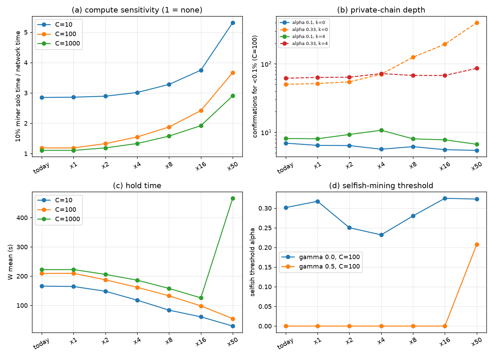

# Slow decay: does a flatter time limit make SM64Coin compute-dependent (PoW-like)?

Question: if the limit relaxed far slower, the shortest run would win and compute would buy shorter runs, so block timing and private-chain cost would depend on compute.
Phase 1 measured the real run-length-vs-compute curve (`MEASURE.md`); phase 2 (this file) plugs it into `hs.py` and sweeps the decay slope.
Code: `slowdecay.py` (sweeps, race simulator, quality fork choice), `slowdecay_report.py` (tables + `slowdecay_summary.png`), raw results `slowdecay_results*.json`, all tables in `slowdecay_tables.md`.

## 0. Answer in short

1. **Measured curve** (36 independent real searches on 3 live-chain targets, `MEASURE.md`): one search = 3127 +- 591 frames, 34 M emulated frames (14.5 core-minutes). Best of n falls
   -10.6% (1->2 searches), -8.3%, -5.4%, **-3.3% (8->16)** per doubling of compute; fit `L(n) = 988 n^-0.62 + 2137` (floor 2050-2280 by bootstrap, but only 36 samples; guided chains found 1713 / 2166 / 2275, so no true floor is resolved).
   Beyond ~2 core-hours per block the elasticity is d ln F / d ln C ~ -0.03..-0.05: **saturating, a floor-like curve**. Seed grinding (a different template/pokes each time) is statistically identical to repeating the search; deep guided search is not reliably better than many shallow ones.
2. **Slow decay does raise the *static* compute sensitivity** (a 10%-miner's solo block time at the network's difficulty, C = 100 machines: 1.19x the network's today; 1.33x at x2, 1.55x x4, 1.88x x8, 2.42x x16, 3.67x for x50),
   **but it does not restore PoW-like security, and it costs stability**:
   - the Monero retarget re-normalises a private chain's difficulty: one octave of difficulty is `decay_halving` seconds of validity time, so the d -> block-time gain scales with the slope and a slow private chain's difficulty falls fast. With block-count fork choice the
     confirmation depth for < 0.1% does **not** improve: at C = 100, alpha 0.33: 50 (today) / 55 (x2) / 71 (x4) / 125 (x8) / 194 (x16) / 1270 (x50); alpha 0.2: 15 / 15 / 16 / 15 / 11 / 63; alpha 0.1: 7 / 6 / 6 / 6 / 6 / 5.
   - run-quality-weighted fork choice (weight (2400/F)^k) **makes it worse** at the k that matter: single-run quality is noise-dominated (sd 19% of F per run against a 3-5% effect of doubling compute), so heavier weights turn the fork choice into a luck contest
     (alpha 0.2, C = 100, today: z(0.1%) 15 for blocks, 18 k=4, 53 k=16, 211 k=40, 177 for the work-equivalent weight 1/CDF).
   - stability gets bad: interval coefficient of variation 0.07 (today) / 0.14 (x2) / 0.24 (x4) / 0.39 (x8) / 0.55 (x16) / 0.81 (x50) at C = 100, p95 interval 334 / 364 / 411 / 486 / 589 / 780 s; x50 at C = 1000 ran away to a 986 s mean block time (retarget loop gain ~ dh/300).
3. **Benefits of slower decay**: hold time W (the head start) falls 209 s -> 187 (x2) -> 162 (x4) -> 133 (x8) -> 98 (x16) -> 55 s (x50) at C = 100, stale rate 5.8% -> 3.1% -> 2.0% -> 1.5%; the #1 miner's share excess is ~0 for all slopes (within +-1.6 pp noise, today +1.7 pp at C = 100). Selfish-mining
   thresholds do **not** move (gamma = 0: 0.23-0.33 for all slopes; gamma = 0.5: below 0.1 for every slope up to x16, 0.21 at x50 only).
4. **Humans**: nobody beats the winner by being 2x slower at any slope (P = 0 everywhere, winners are 2170-2230 frames at C = 100, a human at 2x first find is 6300), but the *time penalty of a longer run* scales with the slope: each +10% in frames costs 35 s today, 70 s x2, 140 s x4, 560 s x16.
   A decent human (run ~1.3x the winner's) loses by ~1 block today, ~4 blocks at x4, ~16 at x16: slow decay locks manual miners out long before it buys any security.
5. **Recommendation**: do **not** slow the decay as a security measure (it does not give compute-dependence in the sense that matters, and the measured curve is too flat for it to). If you want less head start / fewer stale blocks, a mild x2 is nearly free; do not go beyond x4 (see section 4).
   Private-chain cost has to come from elsewhere (publication-gated seeds / `AtPublish`, `RESULTS.md` sec. 5, confirmation depth >= 15 for a 20% attacker and >= 50 for 33% under today's rules).

## 1. Model

`hs.py` event simulator with the real Monero retarget (window 60, cut 6, target 300 s) and these changes:
- **Run model = the measurement.** A "dot" is one finished search (`Model.draw`): `F = f0 + lognormal(mu, sigma)` fitted to the 36 measured single searches (`measure_model.json`), floor `f0 = 1500` (central; mu 7.33, sigma 0.37 on F - f0), so
  median 3036, sd 591, and the best of n then follows min-of-iid draws (which is what the measurement shows for S and G, Result 3 of `MEASURE.md`). Sensitivity: `f0 = 1000` (fatter lower tail) and `f0 = 2000` below. A miner with share a of C machines gets dots at rate
  `a C / tau`, `tau = 871` CPU-s per search, so **C counts single-core machines**: C = 10 is ~0.35 dots per block, C = 100 ~ 3.4 dots per 300 s block, C = 1000 ~ 34.
  (CPU-seconds were measured on a loaded machine; on idle cores `tau` is perhaps 2x smaller, i.e. every C below is about 2x too small.)
- No per-miner "effort improves quality beyond min-of-iid" term: the guided arm did not show a reliable gain (3 chains), so `kappa = 0` (the hook exists: `Model.kappa`).
- Shapes (`rules.rs`: `decay_halving` = dh seconds per halving, `start_halvings` = sh): **today** dh 60, sh 20; **x1** dh 60, sh 0 (identical to today for d >> 1, the sh = 20 offset only matters at the d = 1 floor); **x2** dh 120, **x4** 240, **x8** 480, **x16** 960, **x50** 3000, all with sh = 0
  so that the d >= 1 floor never binds (the retarget settles at log2 d ~ 16-22). To keep today's 20-minute ramp at d = 1 you would set sh = 10 / 5 / 3 / 2 / 1 for x2..x16; that detail does not change anything above the floor.
- Fork choice: block count (`weigh_by_blocks`, today) or chain weight = sum of (2400 / F)^k over blocks (`ByQuality`, k = 1, 2, 4, 16, 40), or the work-equivalent weight 1/CDF(F) of the fitted single-search law.
- Retarget: the real algorithm, run on the **private chain too** (its timestamps are the validity times its own runs allow), which is what drives (b).
- Miners as in `RESULTS.md`: honest-rational with H = 120 s commit (head start), 2 s propagation, ties first-seen. Not modelled: a deadline-valid "flat" mode (valid at parent + D for everyone; then every chain advances 1 block per D regardless of compute, so block counting gives
  zero resistance to any attacker that finds a single valid run per window; the x50 row is the nearest thing we simulate).

## 2. Results (selected; every table is in `slowdecay_tables.md`)

### (a) compute sensitivity, mean solo block time (s) at the network's difficulty

| shape | C=100 network | 33% | 20% | 10% | 10%/network | C=1000: 10%/network | C=10: 10%/network |
|---|---|---|---|---|---|---|---|
| today | 311 | 334 | 348 | 369 | 1.19 | 1.11 | 2.85 |
| x2 | 317 | 360 | 382 | 422 | 1.33 | 1.19 | 2.89 |
| x4 | 327 | 403 | 442 | 506 | 1.55 | 1.33 | 3.01 |
| x8 | 343 | 470 | 536 | 644 | 1.88 | 1.58 | 3.28 |
| x16 | 335 | 529 | 641 | 811 | 2.42 | 1.92 | 3.75 |
| x50 | 343 | 675 | 885 | 1257 | 3.67 | 2.90 | 5.31 |

(The C = 10 column is the search-bound regime: even today a 10% miner is 2.85x slower simply because it finds a run every ~2.5 hours; that is compute dependence of the quiet network, not of the limit.)
At the same time the winning run barely changes: 2234 -> 2172 frames (p50) from today to x50: the limit's slope trades time, not run quality.

### (b) private-chain race (confirmations z for < 0.1% success, C = 100, block-count fork choice; fork at the tip, honest side (1-alpha) C, attacker alpha C, both with the real retarget)

| shape | alpha 0.1 | alpha 0.2 | alpha 0.33 | P(z=6) at 0.33 |
|---|---|---|---|---|
| today | 7 | 15 | 50 | 21% |
| x2 | 6 | 15 | 55 | 22% |
| x4 | 6 | 16 | 71 | 24% |
| x8 | 6 | 15 | 125 | 28% |
| x16 | 6 | 11 | 194 | 36% |
| x50 | 5 | 63 | 1270 | 56% |

Quality-weighted fork choice (alpha 0.33, C = 100, z(0.1%)): k = 1: 53 / 58 / 71 / 84 / 110 / 314 for today, x2, x4, x8, x16, x50; k = 4: 62 / 64 / 72 / 68 / 68 / 86; k = 16 and k = 40 and the work-equivalent weight are far worse in every cell (e.g. today alpha 0.1: 24 / 131 / 115 for k = 16 / 40 / work, alpha 0.2: 53 / 211 / 177; see `slowdecay_tables.md` (b2)). The one place a mild weight helps is at the steep slopes, alpha 0.33: x16 194 -> 68 (k=4), x50 1270 -> 86 (k=4), i.e. it removes the damage the slope does, but never gets below today's 50.
Why: block times are nearly deterministic here (CV 0.07), so a private chain with a slower rate falls behind linearly and cannot catch up, **until its retarget catches up** (window 60, cut 6, i.e. a few tens of blocks); the slope multiplies how fast d adapts (1 octave = dh seconds of validity time),
so the longer the private chain the more it behaves like a full-speed chain. That is exactly the failure of block-count fork choice without a work-like weight (a PoW chain avoids it by weighing by cumulative work), and a quality weight cannot supply work because the quality signal is too flat and noisy (measured elasticity -0.03..-0.05, per-run sd 19%).
Floor sensitivity (C = 100, block count): with `f0 = 1000` z(33%) = 55 / 56 / 68 / 85 / 115 / 239 (today..x50); with `f0 = 2000` it is 49 / 50 / 64 / 212 / 1865 / 8233: the more saturated the curve (higher floor), the worse a slow slope behaves.

### (c) hold time W, #1 miner (40/30/20/10 compute), H = 120

| shape | W mean (C=100) | stale | #1 excess (pp) | interval CV | p95 interval |
|---|---|---|---|---|---|
| today | 209 | 5.8% | +1.7 | 0.07 | 334 |
| x2 | 187 | 3.1% | +1.6 | 0.14 | 364 |
| x4 | 162 | 2.0% | +0.4 | 0.24 | 411 |
| x8 | 133 | 1.5% | -0.3 | 0.39 | 486 |
| x16 | 98 | 1.2% | +0.3 | 0.55 | 589 |
| x50 | 55 | 0.9% | -0.2 | 0.81 | 780 |

(C = 1000: W 222 / 206 / 186 / 158 / 126 and x50 unstable.) The head start shrinks as the slope flattens (it is W/dh worth of levels) and the #1 excess is within noise for all of them.

### (d) selfish mining (SM1, H = 120, block-count fork choice; threshold = smallest alpha with revenue share > alpha, C = 100)

| shape | gamma 0 | gamma 0.5 | share at alpha 0.25 (gamma 0) |
|---|---|---|---|
| today | 0.30 | <0.1 | 0.19 |
| x2 | 0.25 | <0.1 | 0.25 |
| x4 | 0.23 | <0.1 | 0.26 |
| x8 | 0.28 | <0.1 | 0.23 |
| x16 | 0.33 | <0.1 | 0.22 |
| x50 | 0.32 | 0.21 | 0.20 |

No slope fixes withholding; the retarget cancels the compute dependence for a private chain (see b). Only x50 reduces the gamma = 0.5 exposure, at the price of a 780 s p95 interval.

### (e) retarget stability

Mean block time after a x4 / x1/4 compute step, 20-block windows 1-3, 6, 12 (C = 100): today 275, 283, 287, 292, 297 / 323, 338, 312, 321, 297; x4: 243, 233, 306, 301, 280 / 332, 353, 345, 291, 348; x16: 175, 264, 380, 345, 330 / 411, 407, 277, 293, 289.
Interval CV grows ~ linearly with the slope (table c); with the loop gain `dh/300` the Monero update (d *= target/observed over a 60-block window with cut) overshoots from x4 on. x50 at C = 1000 ran away (986 s mean).

### (f) humans / manual miners

A human run of 2x the search's median first find (6300 frames) never beats a machine winner (2170-2230 frames at C = 100), at any slope: P(F_win >= F_h) = 0. The time cost of a longer run is `7.5 s * (dh/60) * ln(F_h/F_win)/0.0202`:
a human at 1.3x the winner (~2900 frames) loses by ~100 s today (a third of a block), ~390 s at x4 (1.3 blocks), ~1560 s at x16 (5 blocks); at 2x first-find: 373 s today (1.2 blocks), 1512 s x4 (5), 6099 s x16 (20). Slower decay therefore does not help humans and prices them out much faster than machines.
(No manual-mined blocks can be identified on the chain: the 10 blocks in the current cycle are 2313-5449 frames, all consistent with the search's own range.)

## 3. Why it fails, in one paragraph

Compute-dependence of a block needs **work** to be a function of the block alone. Here the limit is a deadline that the retarget moves so that the best available run is valid at ~300 s: when compute doubles the network's run gets 3-5% shorter (measured, at >= 8 searches per block), the retarget raises d by a few levels, and block time returns to 300 s.
A slow slope only changes the conversion between the run quality and seconds (and thus the retarget's gain), not the amount of work that is observable in a block. A private chain with a fraction of the compute has blocks that look slightly worse (2300 vs 2200 frames), and its own retarget quickly lowers d to compensate; block-count fork choice ignores the difference and a
quality weight cannot amplify a 3-5% effect over a 19% per-run noise. A real fix needs a work-like quantity that is large and sharp in the block: e.g. a commit-reveal/beacon that makes private building impossible (`AtPublish`), or an explicit hash puzzle on top of the run.

## 4. Recommended `rules.rs` values

- **Keep** `decay_halving: 60, start_halvings: 20` unless head start / stale rate is the problem.
- If W and stale rate should be lower: **`decay_halving: 120, start_halvings: 10`** (x2): W -10% (209 -> 187 s), stale 5.8% -> 3.1%, interval CV 0.07 -> 0.14, p95 334 -> 364 s, no change in z(0.1%) (6 / 15 / 55), no loss for humans (+~1 block at worst). Hard ceiling **`decay_halving <= 240` (x4)** (CV 0.24, p95 411 s, z(33%) 50 -> 71); from x8 up (`decay_halving >= 480`) the retarget gets noisy (CV >= 0.39) and private-chain depth gets worse at 33% (125-1270).
- Do not use `weigh_by_blocks() == false` with quality or difficulty weights as the answer: every variant tried (k = 1..40, 1/CDF) is no better and mostly worse than block counting; if private-chain cost is the goal, gate the next block's seed on publication (see `RESULTS.md`), and quote the confirmation depth: **>= 15 blocks for a 20% attacker, >= 50 for 33%** under any of these shapes (C = 100).

## 5. Caveats

- The run model rests on 36 searches (3 targets, 6-7 per arm each): the floor is not resolved (guided chains went to 1713-2275), per-target fits are noisy, "C" is in loaded-machine CPU-seconds, and one native core is not a web miner. The sensitivity to the floor (f0 1000 / 1500 / 2000) is shown for (a)-(c); conclusions do not change, saturation makes slow slopes worse.
- Dots are iid searches of equal cost; the aggregate honest side in (b) is one miner with (1 - alpha) C (no sub-miner competition), no latency, attacker gets no head start beyond H = 120. z(0.1%) comes from a log-linear tail fit on 1200 trials per cell (resolution ~0.1%; values > 100 are extrapolations).
- Sweeps used the model from the first 36 searches (3 targets); the guided arm (3 chains) was too small to calibrate `kappa`.
- The "flat with a fixed deadline" extreme was not simulated as a separate rule; x50 (dh = 3000 s, i.e. one halving per 50 minutes) is the closest, and by the argument in section 1 a pure deadline gives no block-count resistance at all.
